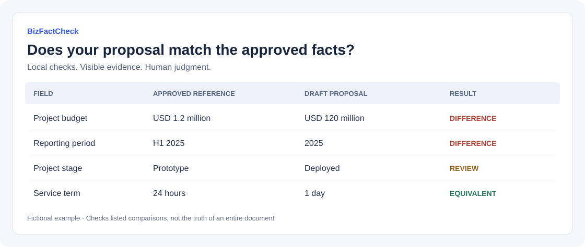

# BizFactCheck

**Catch business-document discrepancies before you send the proposal.**

[English](README.md) · [简体中文](README.zh-CN.md)

An offline checking tool and agent skill for proposals, project reports, and handover documents. Compare a draft with your chosen reference, then see **what differs, where it appears, and what needs a person's judgment**.



## A business example, in 30 seconds

Your approved project note says **USD 1.2 million**, **first half of 2025**, and **prototype**. The proposal says **USD 120 million**, **all of 2025**, and **deployed**. A polished document can still make the wrong promise.

| Approved reference | Draft proposal | What to check |
|---|---|---|
| USD 1.2 million | USD 120 million | Amount differs |
| H1 2025 | 2025 | Reporting period differs |
| Prototype | Deployed | Stage changed; human review |
| Standard modules | All modules | Scope changed; human review |
| 24 hours | 1 day | Equivalent supported duration |

These are **synthetic examples**, not customer data or measured business outcomes. The included corrected draft also demonstrates that different formatting need not be an error.

## Try it locally

Python 3.9 or newer. No model, API key, account, GPU, or runtime third-party package is needed.

```bash
git clone https://github.com/linghaohe/bizfactcheck.git
cd bizfactcheck
python -m venv .venv
```

Activate the environment: `source .venv/bin/activate` on macOS/Linux, or `.venv\Scripts\Activate.ps1` in Windows PowerShell. Then:

```bash
python -m pip install .
bizfactcheck check --source examples/en/reference.md --draft examples/en/proposal-errors.md
bizfactcheck check --source examples/en/reference.md --draft examples/en/proposal-corrected.md
```

The first command deliberately exits **1** because the sample has discrepancies. The corrected example exits **0**. A zero exit means only that the comparisons listed in the report found no discrepancy; it is not a certificate for the whole document.

Prefer Chinese output? Add `--lang zh`, or start with `examples/zh/`.

## Use your own files

### 1. Direct checks for labeled facts

Use a reference and one or more drafts with fields such as:

```text
Project budget: USD 1.2 million
Reporting period: H1 2025
Project stage: prototype
```

```bash
bizfactcheck check --source approved.md --draft proposal.md handover.docx --lang en
bizfactcheck check --source approved.md --draft proposal.md --format html --output review.html
```

Open `review.html` locally to inspect source snippets and locations. Report files are created only at your chosen path; existing files are never overwritten. Use a new output name for a new run.

Supported inputs are UTF-8 **Markdown/TXT** and **DOCX body paragraphs and tables**. Direct checking pairs labeled fields and two-column tables, not every sentence in a document. Repeated labels and unsupported values are surfaced for review. See [supported checks and limits](docs/USAGE.md).

### 2. Evidence-backed checks for prose

For ordinary paragraphs, the included skill helps extract source/draft pairs into a reviewable JSON file. The checker verifies that each quote exists and each declared value occurs in its quote before comparing the values.

```bash
bizfactcheck verify examples/prose/checks.json --format html --output prose-review.html
```

The example manifest is already supplied; this command does not call a model. When you use an AI assistant to create a new manifest, its model still needs to pair the claims correctly. **A valid quote does not prove that two statements have the same business scope.**

## Use as an agent skill

The portable skill is in [`skills/bizfactcheck`](skills/bizfactcheck/SKILL.md). It helps an assistant choose the reference, preserve evidence, run the checker, and separate confirmed differences from review suggestions.

After installing the Python package, copy that folder to your assistant's skill directory, or ask a file-capable assistant to read its `SKILL.md`. Installation/discovery varies by host; copying a file is not proof that every host has loaded it.

Example request:

> Use the bizfactcheck skill to compare this proposal with the approved project note. Check the budget, reporting period, project stage, and service scope. Keep the original files unchanged and show the evidence for each issue.

The CLI is offline. If your assistant uses a cloud model to read your files, the assistant's own data-handling configuration applies. See [privacy and security](SECURITY.md).

## What it checks

| Check | Behavior |
|---|---|
| Supported amount/unit equivalents | Decimal-based normalization; no currency exchange |
| Calendar year, half-year, quarter | Compare recognized reporting periods |
| Supported elapsed durations | For example, 24 hours equals 1 day; months are not silently converted into days |
| Explicit project stages | Same stage matches; a changed stage needs human review |
| Other text, conditions, ambiguity | Review suggestion rather than a claim of semantic truth |
| Evidence manifests | Check literal quote/value anchors before comparison |

The report shows coverage and unpaired fields. **No comparable facts is an error**, not a clean review.

## Boundaries

- A discrepancy is relative to the reference **you selected**. The reference itself may be wrong or outdated.
- It does not autonomously understand every business statement, prove real deployments, audit accounts, or certify compliance.
- It does not calculate arbitrary totals or reason over an entire spreadsheet. Unsupported values remain review items.
- PDF/OCR, Excel, slides, DOCX headers/footers, text boxes, and tracked-change interpretation are outside v0.1's supported extraction scope.
- Labeled-field examples and automated tests do not establish accuracy on real enterprise documents. Use source review for important decisions.

## Why this project?

BizFactCheck focuses on **business facts that change meaning when their amount, period, unit, or stage changes**. It combines a bounded deterministic checker with a skill for preparing evidence, and makes unchecked scope visible.

Related projects solve useful adjacent problems: [grounded](https://github.com/fc0web/grounded) checks literal grounding; [DocDiff AI](https://github.com/mxthsu/docdiff-ai) compares document versions; [Proof Loop](https://github.com/LeoStehlik/proof-loop) tracks evidence for coding-task completion. This project does not claim to outperform them; no head-to-head benchmark has been run.

## Develop and contribute

```bash
python -m unittest discover -s tests -v
```

Read [CONTRIBUTING.md](CONTRIBUTING.md) before reporting a false alarm or missed discrepancy. Share a **small synthetic reproduction**, never a confidential contract or customer report. Confirmed fixes should include regression tests.

Status: **v0.1.0 alpha**. See [CHANGELOG](CHANGELOG.md) and [ROADMAP](ROADMAP.md). Feedback and reproducible examples matter more than a large feature list. If the tool helps your work, a GitHub Star helps other users discover it.

[MIT license](LICENSE) · Created by [Linghao He](https://github.com/linghaohe)
