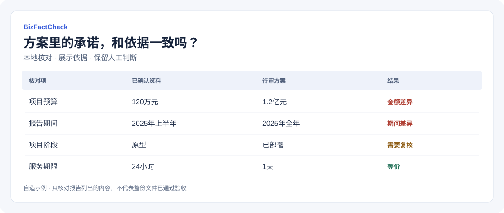

# BizFactCheck · 业务事实核对

**方案发出去之前，先检查金额、时间和成果状态有没有写错。**

[English](README.md) · [简体中文](README.zh-CN.md)

一个本地运行的核对工具和 Agent Skill，适用于项目方案、业务报告和交付材料。把待审文件与选定的依据放在一起，查看**哪里不一致、依据在哪里、哪些内容需要人工确认**。



## 30秒看懂：一份方案可能写错什么

已确认的资料写着：**预算120万元、统计2025年上半年、完成原型**。方案却写成：**预算1.2亿元、2025年全年、已经部署**。

这些变化可能出现在人工改稿、复制旧材料或使用AI写作之后。BizFactCheck将问题与依据并排展示，方便逐项核对。

| 已确认资料 | 待审方案 | 核对结果的含义 |
|---|---|---|
| 120万元 | 1.2亿元 | 金额不一致 |
| 2025年上半年 | 2025年全年 | 统计期间不一致 |
| 原型 | 已部署 | 阶段变化，需要人工复核 |
| 标准模块 | 所有模块 | 范围变化，需要人工复核 |
| 24小时 | 1天 | 支持范围内的等价时间，不应误报 |

以上全部是**自造案例**，不含客户资料，也不是实际业务效果统计。仓库另附修正版本，演示不同金额和时间写法也可以一致。

## 一分钟试用

需要 Python 3.9 或更新版本。演示与程序运行不需要模型、API密钥、账户、显卡或第三方运行依赖。

```bash
git clone https://github.com/linghaohe/bizfactcheck.git
cd bizfactcheck
python -m venv .venv
```

macOS/Linux 运行 `source .venv/bin/activate`；Windows PowerShell 运行 `.venv\Scripts\Activate.ps1`。然后：

```bash
python -m pip install .
bizfactcheck check --source examples/zh/reference.md --draft examples/zh/proposal-errors.md --lang zh
bizfactcheck check --source examples/zh/reference.md --draft examples/zh/proposal-corrected.md --lang zh
```

第一条核对命令故意返回 **1**，表示示例有差异或待复核内容；修正案例返回 **0**。返回0仅表示报告列出的比较未发现差异，不代表整份文件已经通过业务验收。

## 怎样使用自己的材料

### 方式一：直接核对字段

准备依据文件和待审文件。支持这类明确字段及两列表格：

```text
项目预算：120万元
报告期间：2025年上半年
项目阶段：原型
```

```bash
bizfactcheck check --source 依据.md --draft 方案.md 交付说明.docx --lang zh
bizfactcheck check --source 依据.md --draft 方案.md --lang zh --format html --output 核对报告.html
```

打开本地HTML报告，就能看到问题、来源片段和位置。报告只写到指定的新文件，不覆盖原材料或已有报告；再次运行请更换输出文件名。

支持 UTF-8 **Markdown/TXT** 与 **DOCX正文段落及表格**。直接检查针对明确字段，不会自动理解并核对全文所有句子。重复字段、含义不明的数值等会提示复核。具体见[使用说明](docs/USAGE.zh-CN.md)。

### 方式二：通过Skill核对普通段落

自由文本可以交给配套skill整理为“依据片段—待审片段”的JSON核对清单。程序先检查引文确实存在、数值确实出现在引文里，再做比较。

```bash
bizfactcheck verify examples/prose/checks.json --lang zh --format html --output 段落核对报告.html
```

这条演示命令使用已附带的清单，不调用模型。使用AI生成新清单时，仍需关注匹配关系是否正确：**两段引文都存在，并不证明它们说的是同一业务范围。**

## 安装与使用Skill

技能位于 [`skills/bizfactcheck`](skills/bizfactcheck/SKILL.md)。先安装上述Python包，再将技能文件夹复制到所用助手的skills目录；也可以让支持读取本地文件的助手直接阅读 `SKILL.md`。

不同助手的安装和发现方式不同；文件复制成功不等于所有客户端均已实际加载。

可以这样提要求：

> 使用bizfactcheck技能，对照已确认项目资料检查这份方案，重点核对预算、报告期间、项目阶段和服务范围。保留原文件，逐项说明问题和依据。

程序本身离线运行。如果配套助手使用云端模型读取材料，是否上传内容取决于助手的配置；详见[隐私与安全](SECURITY.md)。

## 首版能检查的范围

| 内容 | 处理方式 |
|---|---|
| 支持的金额与单位 | 精确十进制换算，不进行汇率换算 |
| 年度、半年、季度 | 对识别出的日历期间进行比较 |
| 支持的持续时间 | 如24小时与1天等价，不把月份随意换算成天 |
| 明确的项目阶段 | 相同阶段可匹配，阶段变化提示人工复核 |
| 其他文本与适用条件 | 提出复核建议，不擅自认定语义真伪 |
| 依据清单 | 比较前检查字面引文与数值锚点 |

报告会显示检查覆盖范围与未匹配字段。**没有可比较内容时会报错，不会给出“检查通过”。**

## 使用边界

- 核对依据由使用者选择，依据本身可能过期或有误。
- 工具不证明真实部署、不审计财务、不提供合规认证，也不会自主理解全部业务语义。
- 首版不计算任意复杂合计，也不理解整个电子表格模型；不支持的值会保留为待复核。
- 暂不支持PDF/OCR、Excel、PPT，以及DOCX页眉页脚、文本框和修订状态解释。
- 自造案例和自动化测试不能证明真实企业材料上的准确率。重要结论仍应核对原文。

## 项目为什么值得做

业务材料中的数字、时间范围、单位和成果状态会影响承诺的含义。BizFactCheck用有明确边界的程序检查可计算差异，再用skill帮助组织依据，并展示尚未检查的范围。

相邻项目包括字面依据检查工具 [grounded](https://github.com/fc0web/grounded)、文档版本对比工具 [DocDiff AI](https://github.com/mxthsu/docdiff-ai) 和编程任务证据管理工具 [Proof Loop](https://github.com/LeoStehlik/proof-loop)。本项目没有进行同条件性能对比，不宣称优于这些项目。

## 参与维护

```bash
python -m unittest discover -s tests -v
```

欢迎反馈误报、漏检与明确的业务需求。提交前请阅读[贡献说明](CONTRIBUTING.md)，提供最小的**自造复现样例**，不要上传真实客户合同、姓名、邮箱或敏感报告。确认的修复会配套回归测试。

当前为 **v0.1.0 alpha**，变化见[更新记录](CHANGELOG.md)，后续方向见[路线图](ROADMAP.md)。如果工具对你有用，欢迎点Star，帮助更多人发现它。

[MIT许可证](LICENSE) · 作者：[何凌昊 / Linghao He](https://github.com/linghaohe)
